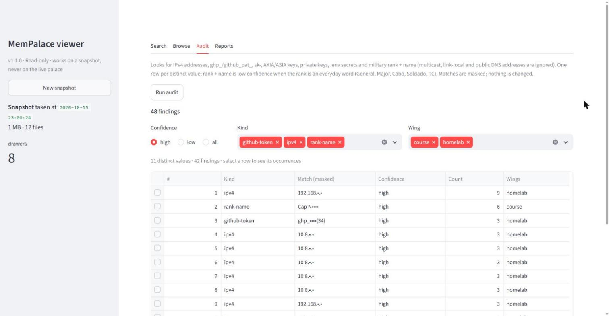

# mempalace-setup

**Português** | [English](README.en.md)

[](LICENSE)
[](https://www.python.org/)
[](https://github.com/pietrogconte/mempalace-setup/actions/workflows/ci.yml)

Setup **global da máquina** do [MemPalace](https://github.com/MemPalace/mempalace) para o Claude Code, em três peças independentes:

1. **`setup_mempalace.py`** — roda uma vez: configura os hooks que salvam o histórico de conversas e uma nota mínima de recall no `~/.claude/CLAUDE.md` global.
2. **`mempalace_sync.py`** — roda todo dia (tarefa agendada): rede de segurança para os hooks e captura do que eles não veem — outras ferramentas de agente, pastas de estudo/projeto e exports do claude.ai/ChatGPT — sempre de forma idempotente e com relatório.
3. **`viewer/`** — viewer mínimo e **só leitura** em Streamlit: busca, navegação, auditoria de dados sensíveis e os relatórios do sync. Trabalha sobre um snapshot e nunca abre o palace ao vivo.

Não pertence a nenhum projeto específico. Funciona em Windows com Smart App Control ligado.

## Quickstart

1. **Setup único:** `python scripts/setup_mempalace.py --dry-run` para ver o diff, depois sem `--dry-run`. Reinicie o Claude Code.
2. **Config do sync:** copie [`config.example.toml`](config.example.toml) para `~/.config/mempalace-sync/config.toml` e ajuste `mempalace.command`, os caminhos e as `[[source]]`.
3. **Simule:** `<python> scripts/mempalace_sync.py --dry-run` e leia `~/exports/reports/<data>-dry-run.md`.
4. **Rode de verdade:** `<python> scripts/mempalace_sync.py`.
5. **Agende:** `<python> scripts/mempalace_sync.py task install --at 21:00`.
6. **Viewer (opcional):** `uv tool install streamlit` e abra pelo comando em [Viewer só leitura](#viewer-só-leitura-viewer).

`<python>` = o python do venv da ferramenta (veja [Windows](#windows-smart-app-control--application-control)), ex.: `C:/Users/<você>/AppData/Roaming/uv/tools/mempalace/Scripts/python.exe`.

### Estrutura

```
.
├── scripts/
│   ├── setup_mempalace.py   # setup único (hooks + nota de recall)
│   ├── mempalace_sync.py    # sync diário (entrada da CLI)
│   └── mpsync/              # config, lock, staging, conversão, normalizador, relatório, tarefa
├── viewer/
│   ├── run_viewer.py        # inicia o viewer em 127.0.0.1
│   ├── app.py               # UI Streamlit (Busca, Navegação, Auditoria, Relatórios)
│   ├── mpbridge.py          # busca, roda no venv do MemPalace, sobre o snapshot
│   ├── mpview/              # snapshot, leitura, filtros, auditoria, relatórios (stdlib, sem UI)
│   └── .streamlit/config.toml  # só 127.0.0.1, estatísticas de uso desligadas
├── config.example.toml      # modelo do ~/.config/mempalace-sync/config.toml
├── tests/                   # unittest com dados fictícios e um MemPalace falso
└── .github/workflows/ci.yml # testes em Python 3.9 e 3.12
```

## Setup único (`setup_mempalace.py`)

```
python scripts/setup_mempalace.py --dry-run   # ver o que mudaria (mostra um diff, não grava nada)
python scripts/setup_mempalace.py             # aplicar
```

Depois de aplicar, reinicie o Claude Code — os hooks só são carregados no início da sessão.

O script:
- Procura um comando `mempalace` que **rode de verdade**, executando `--version`: primeiro `<python do venv da ferramenta> -m mempalace`, depois o lançador `mempalace` do PATH. Só instala (`uv` → `pipx` → `pip`) se nenhum funcionar.
- Configura hooks globais do Claude Code (`Stop`/`SessionEnd`/`PreCompact`, timeout 30) com o comando que funcionou + `hook run` — sem scripts `.sh`, então funciona igual em Windows/Linux/macOS. Hooks do MemPalace já existentes são atualizados, não duplicados. Faz backup do `settings.json` antes.
- Garante uma nota mínima de recall no `~/.claude/CLAUDE.md` global. Se já existir uma nota sobre MemPalace sem o marcador (escrita à mão, em qualquer idioma), ela é envolvida com o marcador em vez de duplicada.
- Imprime onde fica o palace.
- Sai com código 1 se alguma etapa falhar (ex.: `settings.json` com JSON inválido — ele não mexe no arquivo).

Ele não registra o bloco `mempalace rules` (protocolo completo de coordenação multi-agente, MCP com 45 ferramentas) — isso é escopo bem maior do que "memória entre sessões" (`mempalace rules --help`).

## Sync diário (`mempalace_sync.py`)

```
<python> scripts/mempalace_sync.py --dry-run --verbose   # simula: nada vai para o palace
<python> scripts/mempalace_sync.py                       # roda
<python> scripts/mempalace_sync.py --only ia-notes       # só uma fonte ("inbox" = só o inbox)
<python> scripts/mempalace_sync.py normalize export.zip saida/   # só o normalizador
```

Cada rodada, nesta ordem:

1. **Fontes `[[source]]`** do config:
   - `mode = "convos"` — pastas de sessão de agentes. O exemplo traz Claude Code (wing `sessions`, a mesma dos hooks, então nada duplica), Codex, pi e Gemini CLI; pastas que não existem são puladas. OpenCode e Cursor ficam de fora: o MemPalace 3.10 não tem parser para o armazenamento deles.
   - `mode = "projects"` — pastas de arquivos. Sem filtros, minera no lugar. Com `include`/`exclude`/`convert`, minera de um **staging** fora da pasta original (`paths.staging`): HTML e notebooks viram markdown (sem markup, CSS, JS, outputs nem base64), texto UTF-16 é decodificado, e cada arquivo só é regravado se o conteúdo mudou — o MemPalace usa o mtime para saber o que já minerou.
   - Sempre excluídos: `.git`, `.venv`, `node_modules`, `__pycache__` e afins, binários, `.env`, chaves e arquivos com cara de credencial. Uma pasta minerada no lugar que contenha arquivos assim é recusada (configure `include`/`exclude` para ela passar pelo staging).
2. **Inbox de exports** (`paths.inbox`): cada `.zip` do claude.ai ou do ChatGPT é extraído numa pasta temporária, normalizado em um `.md` por conversa (só conversas novas ou com `updated_at` novo são gravadas), minerado, e movido para `paths.processed` — só se o mine deu certo. Transcrições já existentes na pasta de saída são adotadas sem reescrita.
3. **Relatório** em `paths.reports/<data>.md` (rodadas extras no mesmo dia viram `<data>-2.md`, ...): status do palace antes/depois por wing, o que foi minerado, resumo do staging (10 maiores arquivos, duplicatas por conteúdo) e quais páginas de `paths.wiki_sources` podem precisar de curadoria (conversas novas/atualizadas que já têm página) ou ainda não têm página. **A wiki só é lida, nunca escrita.**

**Um escritor por palace:** antes de cada mine o script testa o mesmo lock que o MemPalace usa (`~/.mempalace/locks/mine_palace_*.lock`). Com `lock_policy = "wait"` ele espera até `lock_wait_seconds` e depois pula; com `"skip"` pula na hora. Se outro escritor pegar o lock durante o mine, também conta como pulo. Pulos ficam no log e no relatório, e a próxima rodada recupera.

Log diário em `~/.config/mempalace-sync/logs/`; estado (conversas já vistas) em `~/.config/mempalace-sync/state.json`.

> **`--dry-run` no modo projects:** o `mine --dry-run` do MemPalace não verifica o que já foi minerado nesse modo, então os números são um teto; na rodada real, arquivos com mtime inalterado são pulados. No modo convos a verificação acontece normalmente.

### Tarefa agendada (Windows)

```
<python> scripts/mempalace_sync.py task install --at 21:00   # registrar (ou atualizar)
<python> scripts/mempalace_sync.py task show                 # ver detalhes / última execução
<python> scripts/mempalace_sync.py task run                  # disparar agora
<python> scripts/mempalace_sync.py task remove               # remover
```

A tarefa `mempalace-sync` roda diariamente, **só com o usuário logado** (sem senha armazenada), **executa assim que possível se o horário foi perdido** (PC desligado), nunca roda duas instâncias ao mesmo tempo e tem limite de 4 h. Ela chama o `pythonw.exe` ao lado do python que executou o `task install` (sem janela de console) diretamente com o caminho do script — sem `.bat`, `.ps1` ou `.vbs`. Antes de registrar, confira que esse `pythonw.exe` roda no seu PC:

```
C:/Users/<você>/AppData/Roaming/uv/tools/mempalace/Scripts/pythonw.exe -c "open('pyw-ok.txt','w').write('ok')"
```

Equivalente manual: `schtasks /Query /TN mempalace-sync /V /FO LIST` e `schtasks /Delete /TN mempalace-sync /F`.

## Viewer só leitura (`viewer/`)



*Aba Auditoria num palace fictício: uma linha por valor distinto, toda ocorrência mascarada.*

**Por que um snapshot.** Com o backend Chroma do MemPalace, até uma busca grava no palace: abrir um `chromadb.PersistentClient` escreve no `chroma.sqlite3`, e as verificações antes de abrir podem renomear pastas de segmento HNSW. A opção `read_only=True` do MemPalace só é respeitada pelo backend `sqlite_exact`. Por isso o viewer nunca abre o palace ao vivo. Ele copia o palace para um cache local, e só enquanto nenhum escritor segura o lock do palace (o mesmo teste que o sync faz). Depois confere que o lock continua livre e que nenhum arquivo mudou durante a cópia; se mudou, descarta a cópia e tenta de novo. Se o palace continuar ocupado (o sync das 21h, um mine disparado por hook), o viewer segue mostrando o snapshot anterior, com um aviso. Busca, navegação e auditoria rodam todas sobre a cópia.

- **Busca:** consulta semântica com filtros de wing, room e período (a data é o `filed_at` do drawer). Cada resultado mostra o trecho, a wing/room, o arquivo de origem e as datas. A busca roda no venv do próprio MemPalace (`viewer/mpbridge.py`, que precisa do embedder do MemPalace), sobre o snapshot; a ponte se recusa a rodar no palace ao vivo.
- **Navegação:** wings → rooms → arquivos de origem, com contagem de drawers.
- **Auditoria:** varre todos os drawers atrás de IPv4 (menos loopback, multicast, link-local e DNS públicos conhecidos), tokens `ghp_`/`github_pat_`, chaves `sk-`, chaves AWS `AKIA`/`ASIA`, chaves privadas, segredos de `.env` (placeholders ignorados) e posto + nome (postos do Exército, da Marinha e da FAB seguidos de nome com inicial maiúscula). Uma linha por valor distinto, com contagem e wings; selecione uma linha para ver as ocorrências. Posto + nome tem **confiança baixa** quando o posto é palavra comum (General, Major, Cabo, Soldado, TC); a tabela abre em **alta**. Ocorrências e trechos ficam mascarados na tela e no CSV, e os valores são agrupados por um hash com chave por processo, então nada na tela leva de volta ao valor original. Padrões extras: `[viewer] audit_extra_patterns`.
- **Relatórios:** os relatórios do sync e da curadoria em `paths.reports`, renderizados, e os drawers por wing ao longo do tempo (coluna "Depois" do último relatório do sync de cada dia).

### Instalar e rodar

O Streamlit vai num **venv próprio**, não no do MemPalace (o Streamlit traz pandas, pyarrow e protobuf; o chromadb fixa as versões dele, e um `uv tool upgrade mempalace` desfaria a instalação de qualquer jeito):

```
uv tool install streamlit
```

Com o Smart App Control ligado, nunca use o `streamlit.exe`: sempre o `python.exe` desse venv. O próprio `run_viewer.py` chama `python -m streamlit`. Para abrir o viewer numa **janela nova do PowerShell** (Ctrl+C ou fechar a janela encerra):

```powershell
Start-Process powershell -WorkingDirectory "<repo>" -ArgumentList '-NoExit', '-Command', '& \"$env:APPDATA\uv\tools\streamlit\Scripts\python.exe\" viewer\run_viewer.py'
```

Ele abre `http://127.0.0.1:8501` no navegador (`--no-browser` para não abrir, `--config <caminho>` para outro config). O primeiro carregamento tira um snapshot; **Novo snapshot**, na barra lateral, atualiza.

**Atalho na área de trabalho (opcional).** Um `.lnk` (sem `.bat`/`.ps1`) que abre o viewer numa janela nova do PowerShell, igual ao comando acima. Rode uma vez no PowerShell, trocando `<repo>`:

```powershell
$ws = New-Object -ComObject WScript.Shell
$s = $ws.CreateShortcut((Join-Path ([Environment]::GetFolderPath('Desktop')) 'Viewer do MemPalace.lnk'))
$s.TargetPath = "$env:SystemRoot\System32\WindowsPowerShell\v1.0\powershell.exe"
$s.Arguments = '-NoExit -Command "& (Join-Path $env:APPDATA ''uv\tools\streamlit\Scripts\python.exe'') viewer\run_viewer.py"'
$s.WorkingDirectory = '<repo>'
$s.Save()
```

O `$env:APPDATA` fica literal no atalho e só é expandido quando ele abre. `GetFolderPath('Desktop')` acha a área de trabalho mesmo quando ela está no OneDrive. Para remover, basta apagar o atalho.

### Configuração e segurança

Tabela `[viewer]` do `~/.config/mempalace-sync/config.toml` (veja [`config.example.toml`](config.example.toml)); o caminho do palace, a pasta de relatórios e o `mempalace.command` vêm do resto do arquivo.

| Chave | Padrão |
|---|---|
| `snapshot_dir` | `%LOCALAPPDATA%\mempalace-viewer\snapshot` no Windows (cache local, nunca sincronizado), `~/.cache/mempalace-viewer/snapshot` fora dele. Precisa ficar fora do palace. Só o último snapshot é mantido. |
| `port` | `8501` |
| `language` | `report_language` (`en` ou `pt`) |
| `mempalace_python` | tirado de `mempalace.command = [python, -m, mempalace]` |
| `audit_extra_patterns` | nenhum |

- **Só local:** o `viewer/.streamlit/config.toml` (versionado) e o `run_viewer.py` definem `server.address = 127.0.0.1` e `browser.gatherUsageStats = false`; o próprio app se recusa a rodar se algum dos dois for diferente. A telemetria do chromadb é desligada na ponte de busca.
- **Nunca grava:** o palace ao vivo só é lido por cópia de arquivo; o snapshot é aberto com SQLite `mode=ro&immutable=1`; nada no viewer apaga ou edita drawers.

### Removendo um drawer (pela CLI, se você decidir)

O viewer só aponta. Para remover algo:

1. Corrija a origem antes (apague o arquivo ou o segredo), senão o próximo sync minera de novo.
2. Drawers cujo arquivo de origem foi apagado ou movido: `<python> -m mempalace sync --wing <wing> --dry-run`, depois `--apply`.
3. Um drawer pelo id (coluna *Drawer* da auditoria): o MemPalace 3.10 não tem comando de CLI para isso; use a ferramenta MCP `mempalace_delete_drawer` (ex.: pelo Claude Code com o servidor MCP do MemPalace conectado).
4. Tire um novo snapshot no viewer e rode a auditoria de novo.

## Onde fica o palace (e como conferir)

- **Palace (os dados):** `~/.config/mempalace/palace` — no Windows, `%USERPROFILE%\.config\mempalace\palace`. O caminho vem de `palace_path` em `~/.config/mempalace/config.json`.
- **`~/.mempalace`:** só estado dos hooks e locks (`hook_state/`, `locks/`). Não é um segundo palace.

O palace é **um só por máquina**, compartilhado por todos os seus projetos: uma busca feita a partir de um projeto pode trazer conversas de outro. Se precisar de isolamento real, aponte `palace_path` para caminhos diferentes ou use perfis/máquinas separados.

```
<python> -m mempalace status    # quantos drawers, por wing/room
```

## Windows: Smart App Control / Application Control

Os lançadores `.exe` que o `uv`/`pipx` criam (ex.: `~/.local/bin/mempalace.exe`) não são assinados, e o Smart App Control (ou outra política de Application Control) pode bloqueá-los — às vezes de forma intermitente. O `python.exe` do venv da ferramenta é assinado, então o caminho confiável é chamar o módulo:

```
C:/Users/<você>/AppData/Roaming/uv/tools/mempalace/Scripts/python.exe -m mempalace status
```

Tudo aqui segue essa regra: os hooks e o `mempalace.command` do config usam essa forma, a tarefa agendada chama o `pythonw.exe` do mesmo venv, e o viewer roda com `python -m streamlit` a partir do venv próprio do Streamlit. Bloqueios aparecem no Visualizador de Eventos em *Microsoft-Windows-CodeIntegrity/Operational*.

## Testes

```
python -m unittest discover -s tests -t . -v
```

O CI roda esses testes em Python 3.9 e 3.12 (Ubuntu) **sem o MemPalace instalado**: o sync é exercitado de ponta a ponta contra um CLI falso (`tests/fake_mempalace.py`), com exports, pastas e wiki fictícios. Cobrem: normalizador claude.ai/ChatGPT (incluindo adoção, renomeação e zip-slip), conversão HTML/notebook, staging (filtros, sensíveis, UTF-16, mtime preservado, remoção de obsoletos, duplicatas), config, lock entre processos, parsing da saída do MemPalace, dry-run, inbox e o XML da tarefa agendada. As partes sem interface do viewer são testadas do mesmo jeito, contra um `chroma.sqlite3` fictício: snapshot (lock ocupado, arquivos mudando durante a cópia, palace ao vivo intacto), leitura dos drawers, filtros e ponte da busca, auditoria (cada padrão, falsos positivos, mascaramento, agrupamento, confiança) e o parser dos relatórios; o CI também byte-compila o `viewer/`. **Não** cobrem o `setup_mempalace.py`, o MemPalace real, a UI do Streamlit nem o registro da tarefa no Windows.

## Usando junto com uma LLM Wiki

Combina bem com o [llm-wiki-template](https://github.com/pietrogconte/llm-wiki-template), mas as duas coisas são independentes: a wiki é um molde por projeto; este setup é por máquina.

| | LLM Wiki (`wiki/`) | MemPalace |
|---|---|---|
| O que guarda | Síntese **curada**: só o que o agente decidiu que valia a pena virar página | Histórico **verbatim** de tudo — cada conversa, sem filtro |
| Onde vive | Dentro do repositório da wiki, versionado no git | Fora de qualquer repo, num palace único por máquina (`~/.config/mempalace/palace`), **compartilhado entre todos os seus projetos** |
| Você lê direto? | Sim — é markdown, abre no Obsidian, é o produto final | Não — é uma busca (`mempalace search`), não um lugar pra navegar |
| Quando o agente usa | Sempre, pra responder sobre o que **já está** documentado na wiki (`wiki/index.md`) | Só quando falta contexto que não chegou a virar página ainda — ex.: "o que discutimos sobre X na semana passada?" |

Na prática: a wiki é a "versão final" que você cultiva; o MemPalace é uma rede de segurança que evita perder o que ainda não foi promovido a página. O relatório do sync faz a ponte: aponta quais páginas de `wiki/sources/` podem ter ficado desatualizadas — a curadoria continua sendo sua (ou do agente da wiki).

## Créditos

- MemPalace: [MemPalace/mempalace](https://github.com/MemPalace/mempalace) (MIT).
- Estes scripts foram montados com [Claude Code](https://claude.com/claude-code).

## Licença

MIT — veja [LICENSE](LICENSE).
